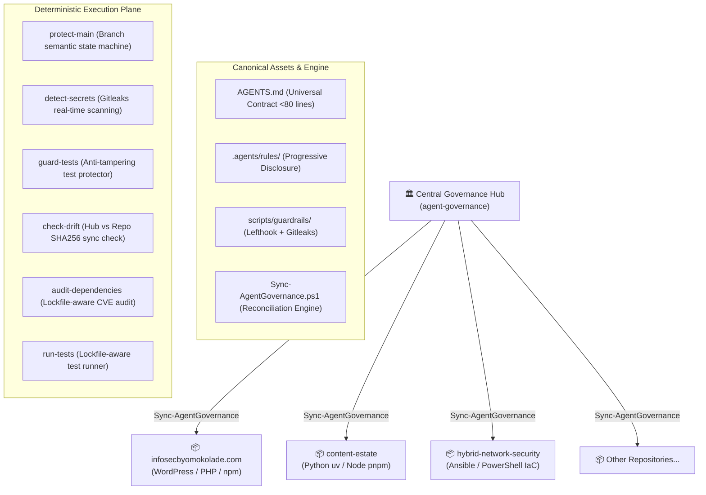

# 🛡️ Agent Governance

> **Enterprise-Grade Multi-Agent Governance, Deterministic Guardrails, and Context Architecture for Autonomous AI Coding Agents.**

`agent-governance` establishes a synchronized hub-and-spoke governance engine across software repositories. It enforces RFC 2119 operational contracts, deterministic pre-commit/pre-push guardrails (via Lefthook and Gitleaks), Progressive Disclosure domain constraints, and automated hub-to-repo drift detection—without token bloat or attention degradation.

---

## 🏛️ Architecture Overview



---

## 🚀 Quickstart & CLI Reference

The engine is loaded into your PowerShell profile (`$PROFILE`) and provides rich subcommands and short parameter switches.

### CLI Syntax:

```powershell
Sync-AgentGovernance [[-Action] <sync|audit|status|help>]
                     [-RepoPath|-r <path>]
                     [-All|-a]
                     [-FleetRoot <path>]
                     [-WhatIf]
                     [-AuditOnly|-m]
                     [-BranchAndCommit|-c]
                     [-Help|-h|-?]
```

### Subcommands & Common Commands:

| Command                            | Short Alias                             | Description                                                           |
| :--------------------------------- | :-------------------------------------- | :-------------------------------------------------------------------- |
| `Sync-AgentGovernance`             | `Sync-AgentGovernance sync`             | Reconciles governance in current directory.                           |
| `Sync-AgentGovernance -h`          | `Sync-AgentGovernance help`             | Displays the interactive CLI reference manual.                        |
| `Sync-AgentGovernance status`      | —                                       | Inspects Central Hub health, active rules, and guardrails.            |
| `Sync-AgentGovernance audit -a`    | `Sync-AgentGovernance -All -AuditOnly`  | Performs a read-only audit across all repositories.                   |
| `Sync-AgentGovernance -r <dir> -c` | `Sync-AgentGovernance -BranchAndCommit` | Syncs target repo, branches to `chore/agent-governance`, and commits. |
| `Sync-AgentGovernance -a -c`       | —                                       | Fleet-wide safe sync and automated commit across all clean repos.     |

---

## ⚡ Core Capabilities

### 1. The Lean Universal Contract & Dual-Contract Layering

- Root [`AGENTS.md`](template/AGENTS.md) is kept ultra-lean (<80 lines) to prevent context diffusion and token exhaustion.
- **Precedence:** Universal operating rules (branch semantics, conventional commits, secret shielding, test anti-tampering) hold absolute veto power.
- **Domain Memory:** Pre-existing custom agent instructions in existing repositories are automatically archived into `docs/LEGACY-AGENT-NOTES.md` and cited as mandatory domain logic in `PROJECT.md`.

### 2. Intelligent Git Hook Chaining

- Detects custom `core.hooksPath` configurations (e.g. `.githooks/` or `.husky/`).
- Scans backward from terminal `exit 0` statements and inserts Lefthook chains non-destructively.
- Automatically resolves external hook paths to keep repositories strictly isolated.

### 3. Automated Hub Drift Detection

- Pre-commit checks SHA256 hashes of local rules against the Central Hub.
- If updates are committed to `agent-governance`, downstream repositories immediately notify developers:
  ```
  ⚡ [Agent Governance] Local repository rules have drifted from the Central Hub.
     Run 'Sync-AgentGovernance' to synchronize with latest corporate standards.
  ```

### Portable distribution and integrity verification

Run `. ./Sync-AgentGovernance.ps1` to load the engine in PowerShell 7. Preview a
repository update with `Sync-AgentGovernance -RepoPath <path> -WhatIf`. Fleet
operations accept `-FleetRoot`; the default is `AGENT_GOVERNANCE_FLEET_ROOT`, or
the directory containing the hub. Audit and preview modes do not write files.

The engine deploys plain files so tool instructions survive Git checkouts:
`CLAUDE.md` imports `AGENTS.md`, Copilot receives an independent copy, and Claude
rules are copied into `.claude/rules`. Legacy rule junctions are removed without
deleting their targets. Existing Claude and Gemini settings remain team-owned.
New Gemini settings name `AGENTS.md` and `GEMINI.md` as context files.

Each sync writes `.agent-governance.lock` with the hub commit, template dirty
state, and line-ending-normalized SHA-256 digests. Digests occupy separate JSON
lines to avoid treating filenames containing "secrets" as credential assignments.
Git failures stop automatic commit processing and leave changes available for
review. Sync does not install missing dependencies.

Run `pwsh -NoProfile -File scripts/guardrails/verify-governance.ps1` to detect
changes since sync. Without a lock this local diagnostic reports a notice;
it does not establish authenticity. For a trusted comparison, run the verifier
from a separately trusted hub checkout, with the downstream repository as the
working directory and `-HubTemplate <trusted-checkout>/template`. This mode
requires a lock, checks required canonical entries independently of the lock,
and compares managed content with the supplied template. Select the trusted
checkout version yourself; the verifier does not fetch or authenticate the
commit recorded in the lock. Markdown comparisons tolerate whitespace changes.

The reusable CI workflow currently enforces secrets and branch policy. Integrity
verification must be invoked separately from a trusted checkout; neither a
repository-local lock nor its local verifier is a tamper-proof security boundary.

### 4. Lockfile-Aware Polyglot Detection

- Inspects repository manifests (`package.json`, `pnpm-lock.yaml`, `yarn.lock`, `package-lock.json`, `pyproject.toml`, `uv.lock`, `Cargo.toml`, `go.mod`, `ansible/`, `*.ps1`).
- Tailors `PROJECT.md` runbooks and executes exact project-native package managers during supply-chain audits and test runs.

### 5. Session Continuity & Write-Ahead Ledgers (`WORKING.md`)

- Solves multi-agent context loss, turn compaction, and context-window degradation without polluting commit logs.
- Ephemeral task ledgers (`WORKING.md`) track pre-flight branch/HEAD hashes, verification commands, and `next_action` checkpoints.
- Strict git shielding (`.gitignore` + `protect-main.ps1`) prevents `WORKING.md` from ever being committed to source control.
- Completed tasks archive ephemeral state before removal, keeping permanent handover invariant intact.

### 6. Anti-Regression Triad Hierarchy

- Synchronizes permanent institutional memory alongside lean universal contracts.
- Categorizes repository knowledge into three distinct precedence tiers in `PROJECT.md` Section 0:
  1. `[!IMPORTANT]` **Operational Handover Spec:** (`HANDOVER.md` / `docs/CURRENT-STATE.md`) authoritative system architecture and domain models.
  2. `[!WARNING]` **Anti-Regression Lessons Learned:** (`LESSONS_LEARNED.md` / `TRAPS.md`) real-world architectural traps and hard-won postmortems.
  3. `[!NOTE]` **Archived Legacy Agent Instructions:** (`docs/LEGACY-AGENT-NOTES.md`) preserved instructions prior to governance adoption.

---

## 📄 License

MIT License.
