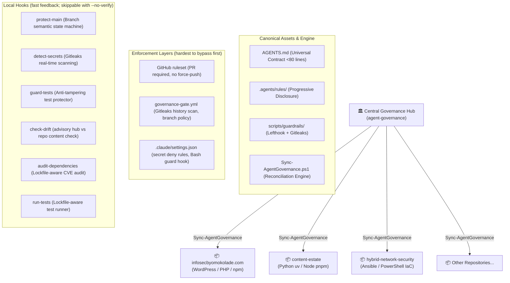

# 🛡️ Agent Governance

> **Multi-agent governance for AI coding agents: one shared contract, layered guardrails, and hub-to-repo distribution.**

`agent-governance` distributes one RFC 2119 operating contract, path-scoped language rules, and guardrails from a central hub to every repository. Guardrails are layered by how hard they are to bypass: server-side rulesets and CI cannot be skipped, Claude Code deny rules and hooks constrain the agent itself, and local Lefthook hooks give fast feedback. Instructions guide agents; only the enforcement layers below actually block anything.

---

## 🏛️ Architecture Overview



---

## 🚀 Quickstart & CLI Reference

The engine is loaded into your PowerShell profile (`$PROFILE`) and provides rich subcommands and short parameter switches.

### CLI Syntax:

```powershell
Sync-AgentGovernance [[-Action] <sync|audit|status|help>]
                     [-RepoPath|-r <path>]
                     [-All|-a]
                     [-FleetRoot <path>]
                     [-WhatIf]
                     [-AuditOnly|-m]
                     [-BranchAndCommit|-c]
                     [-Help|-h|-?]
```

### Subcommands & Common Commands:

| Command                            | Short Alias                             | Description                                                           |
| :--------------------------------- | :-------------------------------------- | :-------------------------------------------------------------------- |
| `Sync-AgentGovernance`             | `Sync-AgentGovernance sync`             | Reconciles governance in current directory.                           |
| `Sync-AgentGovernance -h`          | `Sync-AgentGovernance help`             | Displays the interactive CLI reference manual.                        |
| `Sync-AgentGovernance status`      | —                                       | Inspects Central Hub health, active rules, and guardrails.            |
| `Sync-AgentGovernance audit -a`    | `Sync-AgentGovernance -All -AuditOnly`  | Performs a read-only audit across all repositories.                   |
| `Sync-AgentGovernance -r <dir> -c` | `Sync-AgentGovernance -BranchAndCommit` | Syncs target repo, branches to `chore/agent-governance`, and commits. |
| `Sync-AgentGovernance -a -c`       | —                                       | Fleet-wide safe sync and automated commit across all clean repos.     |

---

## 🔒 Enforcement Layers

Ordered from hardest to easiest to bypass:

1. **Default-branch ruleset (cannot be bypassed from a clone; only repository admins can change it):** applied to GitHub with `./Set-GovernanceRuleset.ps1 -Repository owner/name` (dry-run with `-WhatIf`). Requires pull requests and blocks force-pushes and deletion. Rulesets on private repositories need GitHub Pro, Team, or Enterprise; on a free plan the API returns 403 and this layer is unavailable.
2. **Governance gate (cannot be bypassed from a clone once the ruleset requires it):** the reusable workflow `.github/workflows/governance-gate.yml`, called by commit SHA, scans with Gitleaks (only the commits a pull request or push introduces, so known historical findings do not block every change; full history on the weekly schedule, on manual runs, or with `full_history_secret_scan`), enforces branch naming on pull requests, and verifies managed files against the hub at the commit in `.agent-governance.lock` using the hub's own verifier. For a private hub, pass a read-only `hub_token` secret; without one the integrity job warns and skips.
3. **Agent permissions:** `.claude/settings.json` denies `Read`/`Edit` of secret files, enables Claude Code's OS-level sandbox (macOS, Linux, WSL2; native Windows warns and runs unsandboxed) with reads of credential directories denied, and runs a PreToolUse guard that blocks `--no-verify`, `LEFTHOOK=0`, `lefthook install`, `core.hooksPath` overrides, and pushes to `main`. Wrapper scripts and subprocesses can still evade it, so layers 1 and 2 remain the backstop.
   Codex gets `.codex/config.toml` (workspace-write sandbox, on-request approvals; loaded only for trusted projects), and Gemini CLI gets
   `.gemini/settings.json` (reads `AGENTS.md`; forces confirmation for `git push`, `--no-verify`, `lefthook` and hook-path overrides — prefix matching, not a boundary).
   Sync keeps all three agent settings files current while they are unmodified and never overwrites a team-edited one.
4. **Local hooks:** Lefthook pre-commit and pre-push, fail-closed for detected agent sessions. Skippable with `--no-verify`; the layers above catch what they miss.
5. **Contract and rules:** `AGENTS.md` and `.agents/rules/` guide agents but do not block anything.

## ⚡ Core Capabilities

### 1. The Lean Universal Contract & Dual-Contract Layering

- Root [`AGENTS.md`](template/AGENTS.md) stays under 80 lines (enforced by a test). Claude reads it through a one-line `CLAUDE.md` import.
- Language rules live in `lang-*.md` files with `paths:` frontmatter, so Claude Code loads each one only when it reads a matching file. `security-performance.md` and the short `languages.md` index always load.
- **Precedence:** Universal operating rules (branch semantics, conventional commits, secret shielding, test anti-tampering) hold absolute veto power.
- **Domain Memory:** Pre-existing custom agent instructions in existing repositories are automatically archived into `docs/LEGACY-AGENT-NOTES.md` and cited as mandatory domain logic in `PROJECT.md`.

### 2. Intelligent Git Hook Chaining

- Detects custom `core.hooksPath` configurations (e.g. `.githooks/` or `.husky/`).
- Scans backward from terminal `exit 0` statements and inserts Lefthook chains non-destructively.
- Automatically resolves external hook paths to keep repositories strictly isolated.

### 3. Automated Hub Drift Detection

- Pre-commit compares managed files with the hub template (whitespace-normalized for Markdown). It is advisory and never blocks a commit.
- If updates are committed to `agent-governance`, downstream repositories immediately notify developers:
  ```
  ⚡ [Agent Governance] Local repository rules have drifted from the Central Hub.
     Run 'Sync-AgentGovernance' to synchronize with latest corporate standards.
  ```

### Portable distribution and integrity verification

Run `. ./Sync-AgentGovernance.ps1` to load the engine in PowerShell 7. Preview a
repository update with `Sync-AgentGovernance -RepoPath <path> -WhatIf`. Fleet
operations accept `-FleetRoot`; the default is `AGENT_GOVERNANCE_FLEET_ROOT`, or
the directory containing the hub. Audit and preview modes do not write files.

Sync also installs `.github/workflows/agent-governance.yml`, which calls the gate
pinned to the hub commit. It is written only when that commit is pushed and the hub
template is clean, so downstream CI can always fetch the pin; a same-named workflow
without the managed marker is left alone. Tracked files stored with CRLF although
`.gitattributes` requires LF are renormalized in a separate, content-neutral commit
under `-BranchAndCommit` (otherwise sync warns). Linked git worktrees are supported.

The engine deploys plain files so tool instructions survive Git checkouts:
`CLAUDE.md` imports `AGENTS.md`, Copilot receives an independent copy, and Claude
rules are copied into `.claude/rules`. Legacy rule junctions are removed without
deleting their targets. Existing Claude and Gemini settings remain team-owned.
New Gemini settings name `AGENTS.md` and `GEMINI.md` as context files.

Each sync writes `.agent-governance.lock` with the hub commit, template dirty
state, and line-ending-normalized SHA-256 digests. Digests occupy separate JSON
lines to avoid treating filenames containing "secrets" as credential assignments.
Git failures stop automatic commit processing and leave changes available for
review. Sync does not install missing dependencies.

Run `pwsh -NoProfile -File scripts/guardrails/verify-governance.ps1` to detect
changes since sync. Without a lock this local diagnostic reports a notice;
it does not establish authenticity. For a trusted comparison, run the verifier
from a separately trusted hub checkout, with the downstream repository as the
working directory and `-HubTemplate <trusted-checkout>/template`. This mode
requires a lock, checks required canonical entries independently of the lock,
and compares managed content with the supplied template. Select the trusted
checkout version yourself; the verifier does not fetch or authenticate the
commit recorded in the lock. Markdown comparisons tolerate whitespace changes.

The reusable CI workflow runs this trusted comparison automatically: it checks
out the hub at the locked commit and runs the hub's verifier against the caller.
It also requires the locked commit to equal the gate's own pinned commit (sync
writes both, so a hand-edited downgrade fails) and warns after 30 days / fails
after 90 days of hub staleness (`hub_max_age_warn_days`, `hub_max_age_fail_days`). A repository-local lock and verifier on
their own are not a tamper-proof security boundary.

### 4. Lockfile-Aware Polyglot Detection

- Inspects repository manifests (`package.json`, `pnpm-lock.yaml`, `yarn.lock`, `package-lock.json`, `pyproject.toml`, `uv.lock`, `Cargo.toml`, `go.mod`, `ansible/`, `*.ps1`).
- Tailors `PROJECT.md` runbooks and executes exact project-native package managers during supply-chain audits and test runs.

### 5. Session Continuity & Write-Ahead Ledgers (`WORKING.md`)

- Solves multi-agent context loss, turn compaction, and context-window degradation without polluting commit logs.
- Ephemeral task ledgers (`WORKING.md`) track pre-flight branch/HEAD hashes, verification commands, and `next_action` checkpoints.
- `.gitignore` plus the `protect-main.ps1` pre-commit hook keep `WORKING.md` and `.agents/state/` out of commits on every branch.
- Completed tasks archive ephemeral state before removal, keeping permanent handover invariant intact.

### 6. Anti-Regression Triad Hierarchy

- Synchronizes permanent institutional memory alongside lean universal contracts.
- Categorizes repository knowledge into three distinct precedence tiers in `PROJECT.md` Section 0:
  1. `[!IMPORTANT]` **Operational Handover Spec:** (`HANDOVER.md` / `docs/CURRENT-STATE.md`) authoritative system architecture and domain models.
  2. `[!WARNING]` **Anti-Regression Lessons Learned:** (`LESSONS_LEARNED.md` / `TRAPS.md`) real-world architectural traps and hard-won postmortems.
  3. `[!NOTE]` **Archived Legacy Agent Instructions:** (`docs/LEGACY-AGENT-NOTES.md`) preserved instructions prior to governance adoption.

---

## 📄 License

MIT License.
